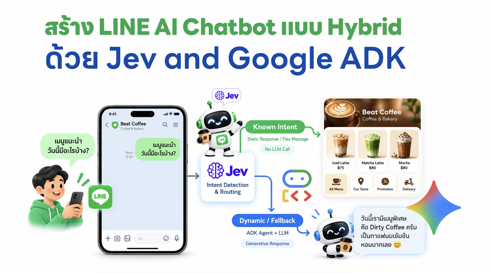
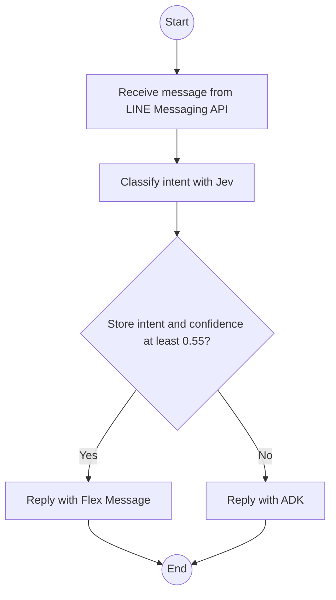
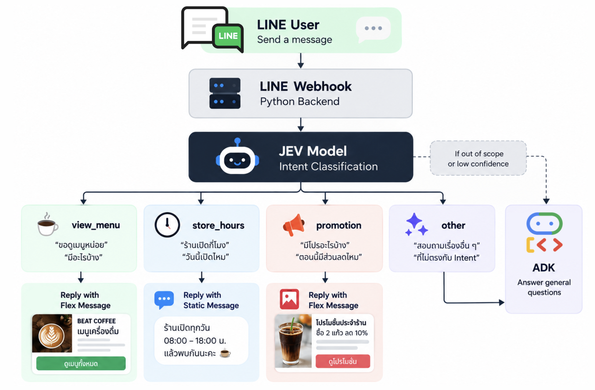

# สร้าง LINE AI Chatbot แบบ Hybrid ด้วย Jev และ Google ADK



BEAT COFFEE answers LINE messages by intent. Jev classifies each text message. A confident store intent gets a short Thai line plus a Flex Message. Anything else goes to the ADK agent.

## Flow





A text message from LINE reaches `callback` in `main.py`. The webhook checks `X-Line-Signature`, then sends the text to Jev (`jev-latest`) through the TypeSafe SDK. Jev picks one intent from `INTENT_CRITERIA` and returns a confidence score. The diagram shows what happens next.

**Confident store intent.** If the intent is a store topic and confidence is at least `0.55`, the bot replies with a short Thai line plus the Flex card in `flex_messages/`. The diagram draws three examples: `view_menu`, `store_hours`, and `promotion`. Every other store intent in the table below uses the same path. This reply returns too quickly for LINE to clear a loading animation, so the bot does not show one.

**Out of scope or low confidence.** If Jev returns `other`, confidence is below `0.55`, or the call fails, the dashed path in the diagram applies. The bot shows a loading animation and sends the same text to the ADK agent. The agent's reply dismisses the animation. The agent keeps one in-memory session per LINE user id, so each customer has a separate conversation until the process restarts.

**Images.** Pictures skip Jev. Gemini describes the image in Thai. If that fails, the question goes to the ADK agent.

## Intents

| Intent | Example | Reply |
| --- | --- | --- |
| `view_menu` | ขอดูเมนูหน่อย | `flex_messages/view_menu.json` |
| `store_hours` | ร้านเปิดกี่โมง | `flex_messages/store_hours.json` |
| `promotion` | มีโปรอะไรบ้าง, สะสมแต้มยังไง | `flex_messages/promotion.json` |
| `location` | ร้านอยู่ที่ไหน | `flex_messages/location.json` |
| `contact` | ติดต่อร้านยังไง | `flex_messages/contact.json` |
| `other` | Anything else | ADK agent, no Flex card |

`CONFIDENCE_THRESHOLD` lives in `jev_intent.py`.

## Setup

```bash
cp .env.example .env
```

Do not commit `.env`.

| Variable | Purpose |
| --- | --- |
| `LINE_CHANNEL_ACCESS_TOKEN` | Reply on LINE |
| `LINE_CHANNEL_SECRET` | Verify `X-Line-Signature` |
| `JEV_API_KEY` | TypeSafe key for Jev. It starts with `apikey_` |
| `GEMINI_API_KEY` | Used by the ADK agent and image descriptions |

In the LINE Developers console, set the webhook URL to the Cloud Run service root and enable **Use webhook**.

## Run locally

```bash
python3 -m venv .venv
source .venv/bin/activate
pip install -r requirements.txt
functions-framework --target=callback --debug --port=8080
```

Point the LINE webhook at a public URL that reaches this process.

## Deploy

`deploy.sh` deploys to Cloud Run in `asia-southeast1` on project `data-beat-labs`. It reads `.env` into a temporary env file and does not upload `.env` itself.

## Files

| File | Role |
| --- | --- |
| `main.py` | Webhook, loading animation, and reply routing |
| `jev_intent.py` | Jev intent classification |
| `flex_messages/` | One Flex card per store intent |
| `adk_agent.py` | ADK agent for unmatched text and failed image replies |
| `gemini.py` | Describes images before the ADK fallback |
| `deploy.sh` | Cloud Run deploy |
